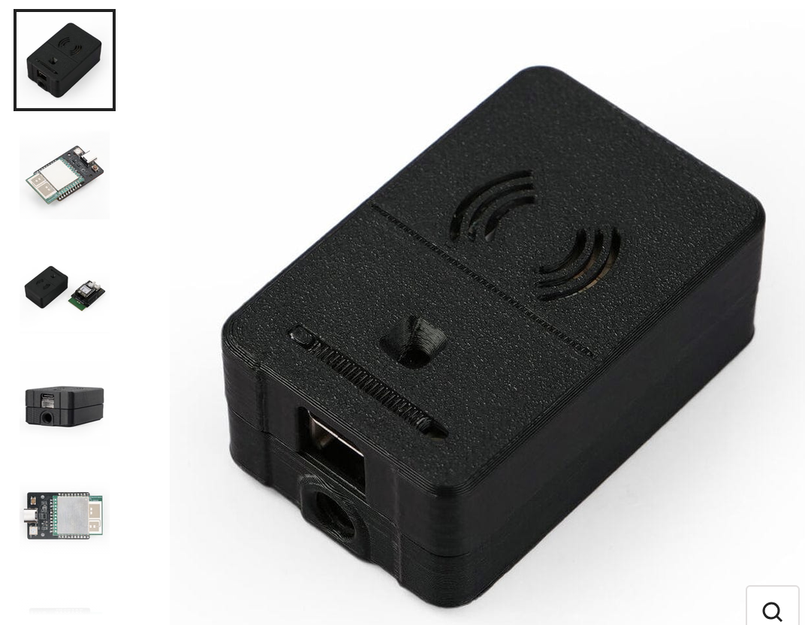

I know this is the wrong way round to look at it, but I've started to buy some components to make the MVP. What I'm realising is that measuring vibrations may not be the best way to tackle this problem. 

It seems that Raspberry Pi already have a component that can detect falls, called a [Seeed MR60FDA2 sensor](https://thepihut.com/products/mmwave-human-fall-detection-sensor-mr60fda2-60ghz). From what I understand, this uses radar that can detect rapid changes in movement within a 3x3x3 m space. Note: a typical room is 5x4, so already this solution wouldn't be fit for the requirement.

It contains
- **a radar module** that runs Seeed's fall detection software - the big challenge here is that this software [isn't open source](https://wiki.seeedstudio.com/getting_started_with_mr60fda2_mmwave_kit/). While this means this can be COTS, it's okay because it's not actually doing exactly what I'd like it to do. Texas Instruments has also [done some research](https://dev.ti.com/tirex/explore/content/radar_toolbox_2_20_00_05/docs/experiments/Fall_Detection_Using_mmWave.html) in this area, [their component AWR6843AOPEVM](https://www.enrgtech.co.uk/product/rf-evaluation-and-development-kits-boards/ET21837925/AWR6843AOPEVM) is a bit pricier around £200-300, so I'll stick with this so far. 
- **a ESP32C6 computer** that reads the results and sends them over WiFi
- **light sensor** - again, another important feature since different light sources will cause changes.
- **LED** which can change colour - this is a really good idea to check its state. 

The challenges with this though is that it has lots of caveats around not putting it near to curtains or other objects that move quickly. This is making me think it'll be important to have some sort of multi-sensor fusion involved somewhere. But this would need to be way down the road.

My god, I hadn't fully thought through things like having it in a bedroom - where people frequently flop onto the bed - may be a challenge. BUT the more I look into it (hands-up, with ChatGPT's help), the more I see that this has been proven as a possibility again and again, and there's even [a GitHub repo](https://github.com/IoT-gamer/iwr6843aop_fall_detection_visualizer). This has shifted my hypothesis from *"Can radar detect a fall?"* to *"Can I build a single-sensor bedroom system that detects genuine falls reliably without repeatedly disturbing people going about their normal lives?"*

Since there's open-source software, this lowers the barrier of entry to others - but since no one has done this yet, maybe it's time someone did. 

**Further thoughts**
- I'm not going to abandon the vibration idea - I think there's something there, and means it can be discreet too, since it will be connected to the floor and not creating another ugly device on the ceiling. Maybe the vibrations will be better at picking up falls in a larger space (bigger than 3x3x3)? 
- I do wonder if both approaches would work - doing some multi-sensor fusion that looks at the radar and the vibrations to double-check if a fall has occurred before raising an alarm to the care provider or family member.
- I think I'll need to test both approaches before I try to start building my own capability. Maybe this tool is good enough for an MVP, we just need to harness it.

**What else I've been up to**
- I've registered for an event to meet some CTOs and test my idea with them. I'd ideally like to take with me some real-world research and tests I've run so I can explore it with them, and show that's not just an idea I'm playing with.

**Next steps**
- I should explore who else has done similar research and absorb what I can learn from them. I've 
